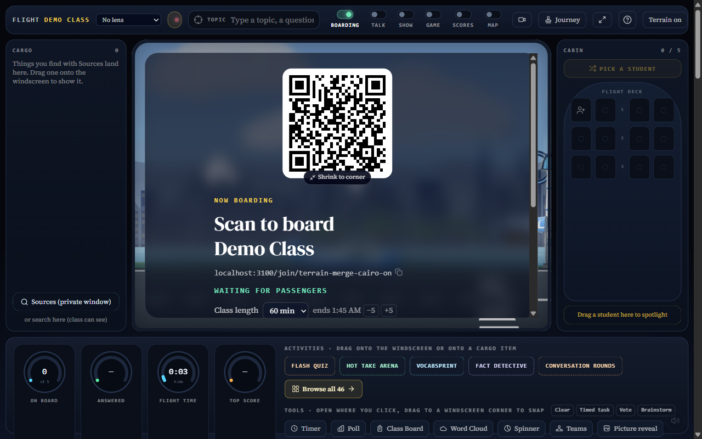

# Terrain 24 live-room rollout — BLOCKED

Draft rollout report, 2026-10-23. No main merge or push was performed. This is not a successful flight or classroom validation.

## Repository state

- Source worktree: C:/Users/insig/.codex/worktrees/terrain-surface/teaching-games, branch codex/terrain-surface.
- origin/main (7ae9025887b27b54451d6bdb0a2797d6b780aad9) merged cleanly locally as 914d1dcf3b4dfa754a829353d65ed557f0ebc9f8.
- Remote terrain branch remains Terrain 24, 092fdff0e00aa78c7f0dd53107a79b1dc6cb19f4. Rollout implementation is uncommitted locally; neither it nor the local merge was pushed.
- Main was not changed. codex/terrain-reports was not merged.

## Local implementation (not released)

Terrain defaults on in the live flight, begins loading during boarding, and uses a six-second elevation deadline. Failed, partial or late elevation loads latch the old scenery for that flight. The preview retains its existing unrestricted loading path. Natural landmark drawings are retained while terrain is unavailable; photo detection remains enabled.

Turn terrain off with `?terrain=off` (or `&terrain=off` when the URL already has a query). A teacher toolbar “Terrain on/off” toggle updates that parameter. These controls are implemented locally, not released or fully flight-verified.

Changed files: src/lib/live-room/flight-surface.ts (new), terrarium.ts, terrain-surface.ts; src/components/live-room/flight/{ground-texture.ts,cockpit-world.tsx,windscreen-flight.tsx,coast-strip-gallery.tsx}; src/components/session/live-room/flight-deck.tsx; src/__tests__/lib/{flight-surface.test.ts (new),terrain-surface.test.ts}.

## Full checks

| Check | Result |
| --- | --- |
| Lint | Exit 0; two existing final-answer hook dependency warnings |
| Full tests | 3,674 passed, 3 skipped; 268 files passed, 1 skipped, 1 failed solely because @mozilla/readability is missing |
| Type check | Sole error: TS2307, missing @mozilla/readability at src/lib/sources/extractor.ts:1 |

Seven new flight-surface tests passed, covering shared preloading, timeout/abort, latched fallback, failed/partial/coarse elevation rejection and the URL off switch. No packages were installed.

## Why the rollout stopped

The actual live-room page was opened in a visible 1280×800 browser. It produced errors beyond the permitted missing readability dependency, so the rollout stopped before Fly:

- Invalid SVG polygon points ending in `Z`.
- Animated SVG ellipse/circle/path attributes set to `undefined`.
- HTTP 500 from /api/beta/status.
- HTTP 400 from session lesson-memory/reference-materials endpoints. The synthetic mock room ID may explain these 400 responses; their cause was not established.

These errors have not been attributed to the terrain changes or proven pre-existing. No unrelated fixes were made after the stop condition.

The existing environment is configured for mock mode. In flight-deck.tsx the window-view channel effect explicitly returns early in mock mode, disabling teacher-to-student-phone broadcasts. Therefore that environment cannot establish that the real phone selfie flow works. No auth/backend settings were changed.

## Unverified release requirements

No Cairo–Rome or Zurich–Milan Fly was completed in either terrain-on or terrain-off mode. Photo chance, window selfie, student phone selfie card and a volcano event were not verified end to end. Tile fallback has unit coverage, not a completed real-room flight test. No FPS or classroom suitability claim is made.

To resume: resolve or explicitly scope the non-readability runtime errors, then provide/use a working real test room with student realtime available. Repeat all requested on/off flights and feature checks before any main merge or push.

## Screenshot

This shows the local teacher Terrain on control and mock boarding screen only; it is not evidence of a rendered terrain flight. No videos are included.
