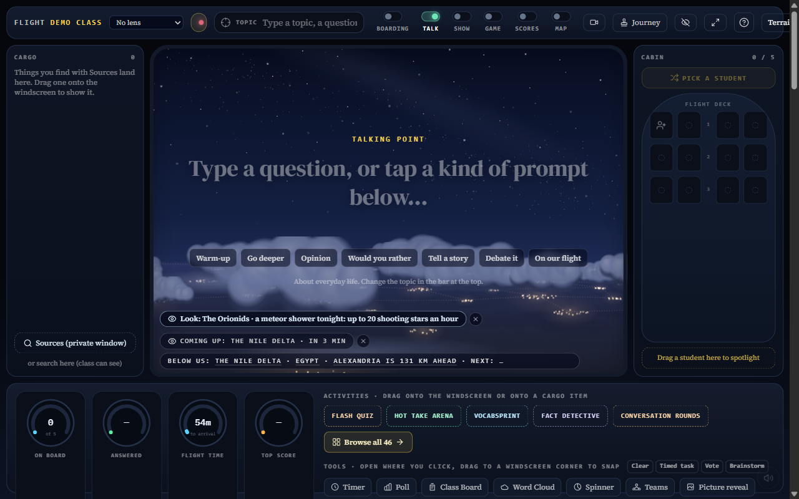

# Terrain 24 merged to main

2026-10-23. Main was merged and pushed after the owner narrowed validation to checking terrain, then requested immediate merge without an off switch.

- Main: 81e8c672d5ad979d4922359ab13d8ee8f4644c65.
- Rollout implementation: 455a2bbe, pushed to codex/terrain-surface.
- The four origin/main changes were integrated cleanly in local merge 914d1dcf before rollout.
- codex/terrain-reports remains separate and was not merged.

## Behavior

Terrain is on by default in real live-room flights. There is no teacher terrain toggle and no `?terrain=off` option. Boarding preloads real elevation. At take-off, incomplete loading gets up to 60 further seconds; failed, partial or late elevation keeps the old scenery automatically for that flight.

The demo-mode beta/status endpoint now returns claimed:false without creating a privileged database client. Invalid polygon close commands were removed and animated SVG geometry has explicit initial values. Fresh browser loading no longer produced those SVG/beta errors.

## Checks and limits

- Full lint: passed, with the two existing final-answer hook dependency warnings.
- Full suite: 3,676 tests passed, 3 skipped. One suite failed solely on missing @mozilla/readability.
- Full type check: only the accepted missing @mozilla/readability TS2307.
- After removing the user switch: 13 focused beta-status and flight-surface tests passed; diff whitespace check passed. No packages installed.
- Actual Cairo–Rome live-room flight, visible 1280×800: terrain ready, route heightfield, Terrarium source, 379 tiles, zero tile failures. An earlier slow load used the automatic fallback. The provisional toggle worked before removal; it is not part of the released UI.
- Teacher/phone selfie and event flows were not completed end to end; the owner explicitly narrowed the check to terrain. Local mock session API 400/room-leg 500 errors still occurred for synthetic fixture rooms; those unrelated mock endpoints were not changed. Production backend behavior was not validated.
- Zurich/Milan exist only in the terrain preview, not the real-room city picker. No completed real-room Zurich–Milan check is claimed. No new performance baseline or classroom suitability claim is made.

## Screenshot

This local flight was at night with clouds. It verifies the live flight wiring, not every mountain view or student interaction. The earlier blocked boarding screenshot remains in this folder as historical evidence, not the final release status. No video recordings are included.

## Cold-route follow-up (2026-10-23)

The owner reported old terrain on the live site after the first rollout. Read-only inspection of the actual live-room canvas confirmed the new bundle was running but `data-terrain=fallback`, no route surface, zero loaded grid tiles. Resource timing showed only 58 Terrarium requests: the six-second deadline aborted a cold route before it could finish.

Changed the take-off deadline to 60 seconds while retaining boarding preload and automatic fallback for failed/incomplete elevation. Flight remains usable during loading. Added a 25-second cold-load regression test; all nine flight-surface tests pass. No packages installed. Fix 8086eae8 was merged and pushed to main as a3d30eb0. Vercel reported the production deployment complete. Reloading the supplied live session showed that the session had ended (arrival screen), so a fresh production terrain-ready state was not verified in that ended flight. No new session was created or class state changed by the agent.
