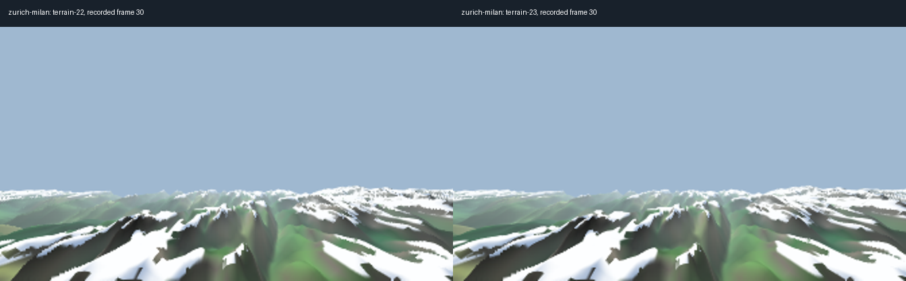
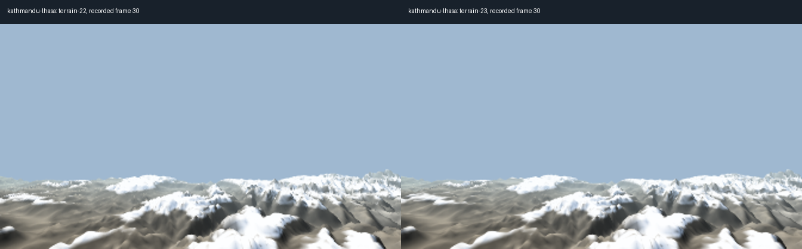
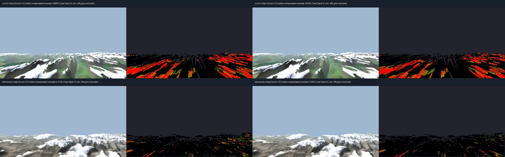

# Terrain 23 — stability draft

Terrain 23 draft
Commit: 6bb697ea (pushed to origin/codex/terrain-surface; no merge or PR).
Changed: src/lib/live-room/terrain-surface.ts; src/lib/live-room/terrain-edges.ts.
REAL_TERRAIN default remains false.

Changes: fade geographically anchored supplemental rows over 6,000 depth units; shade every visible sample; smooth ridge and adjacent-edge confidence; float premultiplied coverage, rounding once. No palette, snow, height, camera or resolution changes.

60 consecutive terrain frames per route/version in visible 1280x800 window. Native layer 336x189, depth/camera motion compensation. Brightness reversals exceeding 8/255 in both directions / eligible opaque pixel triplets. Approximate proxy: steep terrain reprojection and moving detail can also count. Sky and occlusions excluded. Raw screen scores are included in metrics.json. Recordings and raw frame buffers remain local and are intentionally excluded from this branch.
Zurich flicker: 4.983% -> 4.655% (6.6% relative reduction).
Kathmandu flicker: 0.273% -> 0.190% (30.4% relative reduction).

One clean 15-second Fly each: Zurich 56.1 FPS (later seconds near 53); Kathmandu 59.5 FPS. Zero Terrarium requests during both Fly runs. Surface tests: 15 passed. No main baselines, full suite or lint.

Residual foreground shimmer remains, especially Zurich. This is a partial stability improvement, not a flicker-free result or locked 60 FPS. Terrain 22 art settings retained. See comparisons.html for static comparisons and heatmaps; metrics.json contains the measured counts. Local-only recording, raw data and analysis folder: C:/Users/insig/Documents/Codex/_outputs/2026-10-22-terrain-23/.

## Static comparisons

## Flicker heatmaps

Heatmaps share one scale: black = no candidate reversals, red = at least 8% of eligible triplets at that pixel, grey = excluded. Recorded frame index 30 is used for each still comparison; the recorded geographic positions differ slightly.

## Archive policy

This folder contains the round report, static comparison images, heatmaps and small measurement summaries. No videos, animated images, frame sequences or raw recordings are included. Keep `codex/terrain-reports` separate; never merge it. Add future rounds under `reports/terrain-N/`.

