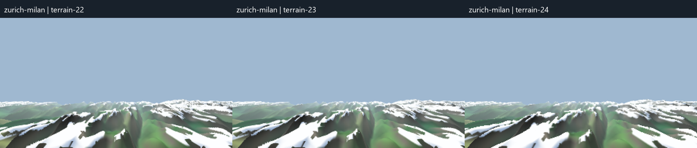
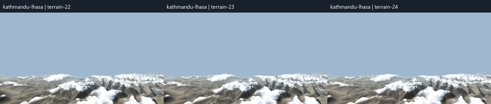
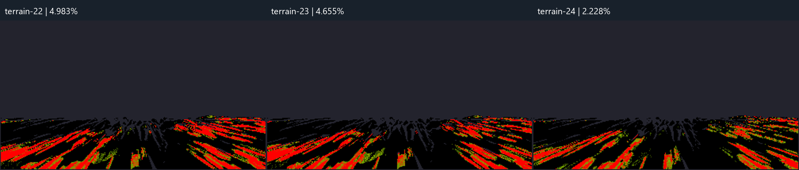
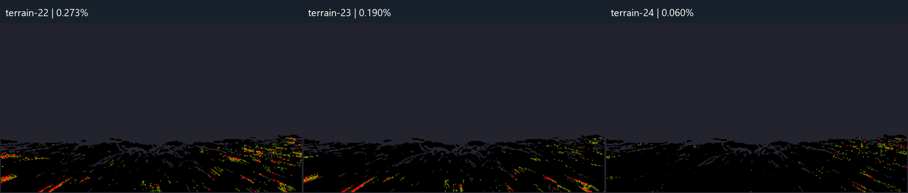

# Terrain 24 — material-edge stability draft

Completed 2026-10-23. Code branch: `codex/terrain-surface`. Code commit: 092fdff0e00aa78c7f0dd53107a79b1dc6cb19f4.
Reports branch: `codex/terrain-reports`, folder `reports/terrain-24/`. Neither branch is merged; no PR. `REAL_TERRAIN` remains false by default. Preview-only overrides enable it for these checks.

## Changes

- A mask-guided, one-internal-pixel reconstruction pass blends snow/rock and contrasting land-material boundaries. A fixed screen-pixel footprint automatically covers more ground with distance. Interior white snow, the snowline, climate colours and height geometry keep their existing parameters. Depth confidence prevents colour bleeding across unrelated terrain layers, the coastline or the skyline.
- Geometry still marches the same geographically anchored rows, including Terrain 23's 6 km row fades. Lighting and material evaluation now happen once per covered raster pixel instead of repeatedly for sub-pixel geometry slivers. Occluding foreground/background material coordinates are kept apart so they cannot average into an unrelated hidden valley.
- Conservative cached bounds include every fine contour-cell corner plus the distant LOD. Targeted comparison against an uncullled render produced identical colour/depth buffers. Linear differential fields are cached at take-off, and snow work is skipped only where a conservative true-elevation bound rules snow out.
- The layer stays 336×189 by default. Preview-only `terrainWidth=400` / `terrainWidth=480` overrides allow the resolution experiments. No new tile fetching during Fly.

## Flicker proxy

60 consecutive terrain frames per route/version, visible headed Chrome at 1280×800. Native analysis resolution is 336×189 for all versions. Terrain 22/23 reuse the original recordings; Terrain 24 uses the final code. All runs begin near route progress 0.267, after three seconds of steady Fly (three-minute route duration). Copy the existing CPU colour/depth buffers; no GPU texture readback.

Primary score: reproject neighbours using depth and recorded camera motion; count up/down or down/up luminance reversals when both changes exceed 8/255. Divide by eligible opaque pixel triplets. Reject offscreen points, transparency and depth disagreement/occlusion. This is an approximate comparative proxy, not a count of proven visible defects.

| Route | Terrain 22 | Terrain 23 | Terrain 24 |
|---|---:|---:|---:|
| zurich-milan | 4.983% | 4.655% | 2.228% |
| kathmandu-lhasa | 0.273% | 0.190% | 0.060% |

Residual shimmer remains. About 24% of all Zurich pixel triplets and 19% of Kathmandu triplets are eligible after excluding sky/occlusions. Terrain 24's 60-frame recordings span 1.399 s / 1.254 s; the earlier recordings span roughly 0.99–1.06 s, so travelled distance and cadence differ. No identical-motion or identical-cadence claim is made.

The unwarped screen-space measure also counts ordinary movement and is included as a secondary check. Kathmandu rises versus Terrain 23 on this secondary measure; the primary result must not be read as a universal improvement in every kind of motion.

| Route | Raw screen 22 | Raw screen 23 | Raw screen 24 |
|---|---:|---:|---:|
| zurich-milan | 3.679% | 3.212% | 0.483% |
| kathmandu-lhasa | 0.608% | 0.147% | 0.271% |

## FPS — 15 seconds per route and resolution

Visible 1280×800 window, day, Fly for three minutes starting at 0.25; twelve-second held warm-up. FPS uses animation-frame counts without recording-buffer copies. All listed runs reported document.hidden=false and zero Terrarium requests during Fly.

| Terrain layer | Zurich–Milan | Kathmandu–Lhasa |
|---|---:|---:|
| 336×189 | 30.0 | 37.1 |
| 400×225 | 28.9 | 38.0 |
| 480×270 | 23.8 | 26.1 |
| 336×189, fresh-session repeat | 52.1 | 52.8 |

The sustained ~60 FPS target is **not established** by these final checks. An earlier development checkpoint reached Zurich 60.1 FPS (terrain step 12.2 ms), but later runs were materially slower, including other drawing steps. The browser window was verified normal and restored/activated; the final repeat uses a fresh Chrome session. The cause of the variation is unconfirmed. The report retains every final measurement rather than treating the best checkpoint as the result. Keep the default resolution at 336×189; higher resolutions do not provide a dependable speed margin here.

Sampling/shading dominated the CPU profile; uploads were small. The changes remove repeated sliver shading and derivative calculations, but that does not justify claiming a stable 60 FPS result on this machine.

Measured higher-resolution cost, relative to the first 336 run:

- 400: Zurich to Milan -3.7% FPS, Kathmandu to Lhasa +2.7% FPS.
- 480: Zurich to Milan -20.6% FPS, Kathmandu to Lhasa -29.7% FPS.

These sequential runs have substantial timing variation (notably Kathmandu 400); small differences are not a reliable isolated resolution cost. Per-step times and per-second bins are retained in fps.json and the raw text outputs.

## Validation and limits

21 targeted surface/material tests pass: coverage, preservation of lighting-only edges and white interiors, no snow leakage across depth layers, and conservative bounds versus uncullled rendering. No full suite, lint, main-renderer baseline, install, merge or PR. Visual draft; no claim of classroom readiness.

The stills isolate the terrain layer on a fixed sky-colour background. Frame index 30 is shown from each recording; geographic positions differ slightly with cadence. Geometry is unblurred; material boundaries have a small pixel-scale softness. Low-resolution foreground detail and residual flicker still need visual approval.

## Static comparisons

## Zurich heatmap

Black = no candidate reversals; red = at least 8% of eligible triplets at a pixel; grey = excluded. The same colour scale is used for all versions.

## Files and archive policy

Code files: `src/lib/live-room/terrain-surface.ts`, `src/lib/live-room/terrain-shading.ts`, `src/lib/live-room/terrain-materials.ts`, `src/components/live-room/flight/cockpit-world.tsx`, and the two targeted surface/material test files.

This archive contains only the round report, static comparison images/heatmaps and small measurement summaries. No videos, animated images, frame sequences, raw frame recordings or CPU-profile recordings. Those remain local in the round's output folder. Keep `codex/terrain-reports` separate and never merge it. Future rounds use `reports/terrain-N/`.
